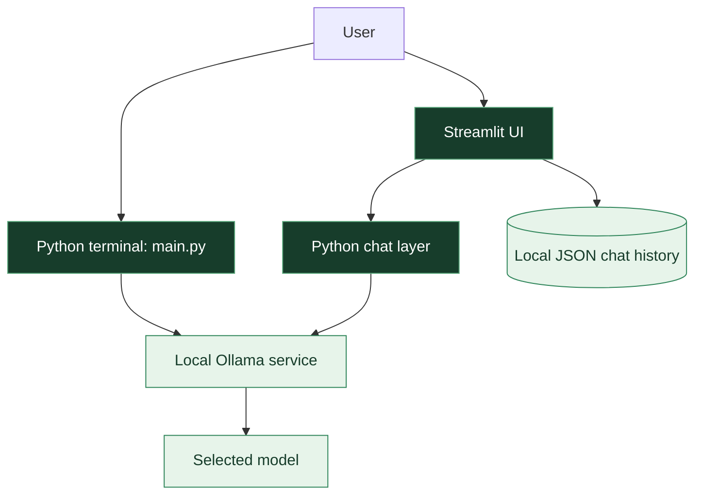

<div align="center">


# Local Coding Assistant

### A local-first coding assistant experiment

Explore local language models through a Python terminal interface and a Streamlit chat UI, powered by [Ollama](https://ollama.com/).

<p>
  
  
  
  
  
</p>

[Overview](#overview) · [Architecture](#architecture) · [Setup](#getting-started) · [Limitations](#current-limitations) · [Security](#privacy-and-security)

</div>

---

## Overview

**Local Coding Assistant** is an experimental Python project for trying locally hosted language models in coding-oriented workflows. It includes two entry points:

- **Terminal:** a lightweight command-line chat loop in `main.py`.
- **Web UI:** a Streamlit interface in `streamlit_ollama.py`, with model selection and JSON-backed conversation history.

The project is intended for learning and experimentation. It has **not** been verified as production-ready, and the complete app has not yet been validated end to end on a clean machine.

## Features at a glance

| Capability | What the repository currently includes |
|---|---|
| Two interfaces | Python terminal and Streamlit web UI |
| Local inference | Connects to an Ollama service at `localhost:11434` by default |
| Model choice in the UI | `qwen2.5-coder:3b` and `qwen3:0.6b` |
| Terminal default | `qwen2.5-coder:3b` |
| Chat history | JSON-backed history for the Streamlit interface |
| Configurable context | UI control for the number of recent messages included |
| Error feedback | Basic handling for Ollama/model errors and unreadable saved history |

> Model identifiers describe the application's configuration; they do not confirm that a model is already installed on your computer.

## Architecture



This is a high-level map of the code paths, not a claim that every path has passed runtime testing.

## Getting Started

### 1. Prerequisites

- Python version compatible with the packages in `requirements.txt`.
- [Ollama](https://ollama.com/) installed and running.
- Enough available memory and CPU/GPU capacity for the model you choose.

### 2. Clone the repository

```bash
git clone https://github.com/amirreza91-13/Local-Coding-Assistant.git
cd Local-Coding-Assistant
```

### 3. Create a virtual environment and install dependencies

**Windows PowerShell**

```powershell
python -m venv .venv
.\.venv\Scripts\Activate.ps1
python -m pip install -r requirements.txt
```

### 4. Download the default model

```bash
ollama pull qwen2.5-coder:3b
ollama list
```

If you prefer another model, confirm that it is available in Ollama and selectable in the app.

### 5. Start an interface

**Terminal**

```bash
python main.py
```

**Streamlit web UI**

```bash
streamlit run streamlit_ollama.py
```

The Streamlit interface should open in your browser. Its CSS and logo are loaded from the repository's `assets/` directory.

## Configuration

The reviewed terminal entry point defaults to:

| Setting | Default |
|---|---|
| Ollama endpoint | `http://localhost:11434` |
| Terminal model | `qwen2.5-coder:3b` |
| Streamlit model options | `qwen2.5-coder:3b`, `qwen3:0.6b` |

Review the source before changing these values. Do not expose the Ollama API to an untrusted network without an intentional, secured deployment design.

## Current Limitations

This is an active learning project. The following work remains before making stronger reliability claims:

- Run both interfaces on a clean environment with documented dependency versions.
- Verify CSS/logo rendering and the full Streamlit chat flow.
- Test saved-history recovery, clearing, and persistence across restarts.
- Exercise missing-model, stopped-service, and malformed-response scenarios.
- Add automated tests for the primary user flows.
- Review context handling, long conversations, and error reporting.
- Add a declared license before describing the project as licensed for reuse.

These are validation tasks, not a claim that every listed area is currently broken.

## Privacy and Security

Local inference can reduce dependence on hosted model APIs, but **running locally does not automatically guarantee complete privacy or security**.

- Keep Ollama bound to a trusted local interface unless remote access is deliberately secured.
- Protect local conversation-history files; they may contain code or personal information.
- Avoid entering credentials, API keys, or sensitive source code into a chat unless you understand how the application stores and processes it.
- Review dependencies, logs, and any future integrations before using the app with sensitive data.

## Roadmap

- [ ] Validate terminal and Streamlit flows end to end.
- [ ] Add automated tests for chat-history persistence and error paths.
- [ ] Improve connection and model-status feedback.
- [ ] Document supported Python and dependency versions.
- [ ] Consider code-context and file-aware workflows after core reliability improves.

## License

No `LICENSE` file was found in the repository when this README was reviewed. Until a license is added, do not assume the project is licensed for reuse or redistribution.

---

<div align="center">

**Build locally. Test carefully. Improve one workflow at a time.**

[Repository](https://github.com/amirreza91-13/Local-Coding-Assistant) · [Report an issue](https://github.com/amirreza91-13/Local-Coding-Assistant/issues)

</div>
