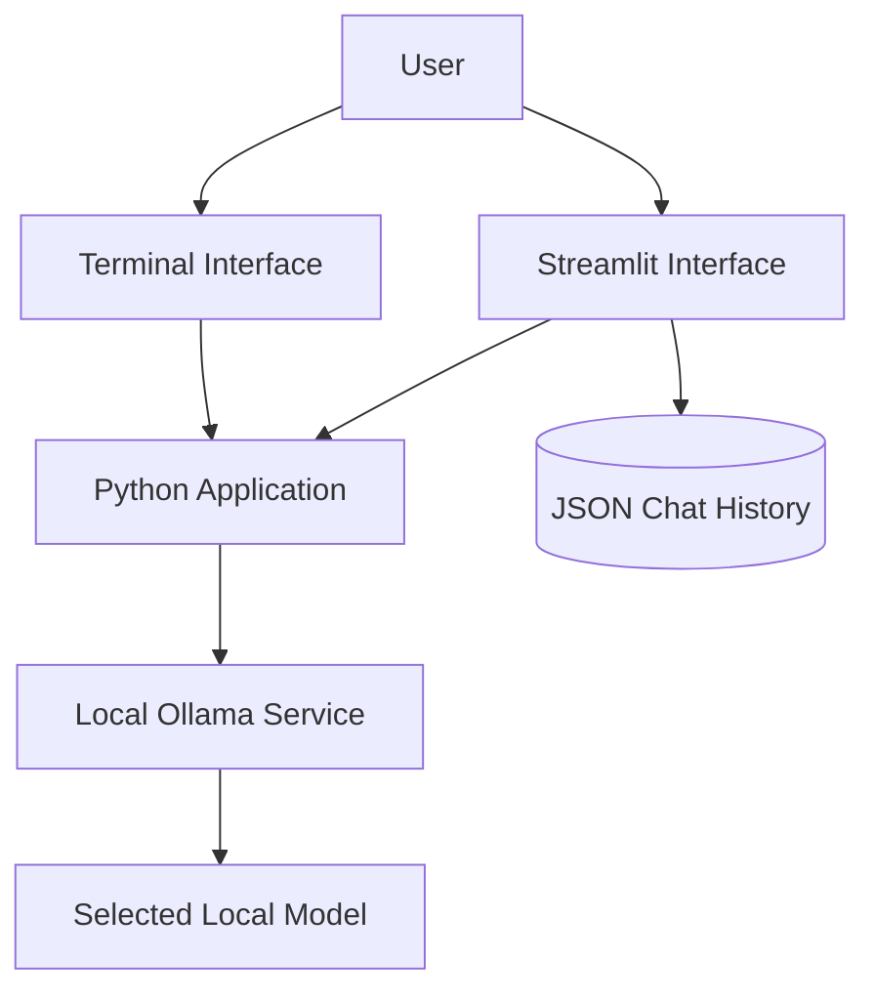

 <div align="center">

# Local Coding Assistant

### Exploring Local LLMs for Coding Workflows

An experimental Python project exploring a coding assistant powered by Ollama, with a terminal entry point and a Streamlit-based interface.


[Overview](#overview) · [Architecture](#architecture) · [Setup](#getting-started) · [Limitations](#current-limitations) · [Security](#privacy-and-security)

</div>

---

## Overview

Local Coding Assistant is an experimental project for interacting with a locally hosted language model through Ollama.

The repository includes:

* A Python terminal entry point.
* A Streamlit-based user interface.
* A default model configuration using `qwen2.5-coder:3b`.
* Local JSON-based chat-history functionality.

The project explores local inference and coding-assistant workflows. It is a learning project, not yet a verified production-ready assistant.

### Project at a glance

| Area | Current implementation |
|---|---|
| Terminal | Python entry point (`main.py`) |
| Web interface | Streamlit (`streamlit_ollama.py`) |
| Inference | Ollama running locally |
| Default terminal model | `qwen2.5-coder:3b` |
| Additional UI model option | `qwen3:0.6b` |
| Chat history | Local JSON file |

> **Status:** Experimental. Runtime behavior still needs end-to-end verification.

## Why Local Models?

Local inference can offer useful development and experimentation options:

* Model requests can be sent to a local inference server.
* Model selection can be adjusted to suit available hardware.
* A local setup can reduce reliance on a hosted inference provider.

However, **local execution alone does not guarantee complete privacy or security**. Behavior depends on the model, application, logs, network configuration, and other services involved.

## Architecture



The diagram summarizes the intended component relationships. It does not certify that every interaction has passed runtime testing.

## Requirements

* Python compatible with the repository's dependencies.
* Ollama installed and running.
* A model supported by the local Ollama installation.
* Sufficient memory and processing capacity for the selected model.

Local model performance depends on model size, quantization, available RAM, CPU, GPU support, and other applications running at the same time.

## Getting Started

### 1. Clone the Repository

```bash
git clone https://github.com/amirreza91-13/Local-Coding-Assistant.git
cd Local-Coding-Assistant
```

### 2. Prepare Python Dependencies

Create and activate a virtual environment.

Windows PowerShell:

```powershell
python -m venv .venv
.\.venv\Scripts\Activate.ps1
```

Install the dependencies pinned in the repository:

```bash
python -m pip install -r requirements.txt
```

For reproducible setup, use a supported Python version and a virtual environment.

### 3. Start Ollama

Install Ollama using its official installation instructions and start the local service.

Check whether the CLI is available:

```bash
ollama --version
```

If the project is configured to use `qwen2.5-coder:3b`, obtain the model:

```bash
ollama pull qwen2.5-coder:3b
```

Verify that the model is available:

```bash
ollama list
```

Model availability, memory requirements, and response speed depend on the local environment.

### 4. Run the Terminal Interface

The repository's terminal entry point is `main.py`:

```bash
python main.py
```

### 5. Run the Streamlit Interface

The repository also includes `streamlit_ollama.py`:

```bash
streamlit run streamlit_ollama.py
```

The Streamlit code references the CSS and logo files included in `assets/`. The interface still needs runtime validation in an environment with the declared dependencies and Ollama models installed.

## Configuration

The reviewed terminal entry point uses the local Ollama endpoint:

```text
http://localhost:11434
```

It also defaults to the model:

```text
qwen2.5-coder:3b
```

Verify these values in the current source before changing the model or endpoint. Keep local service configuration explicit and avoid exposing the Ollama API to untrusted networks.

## Current Limitations

The project is experimental and needs additional validation.

Areas requiring attention include:

* Verifying CSS and logo loading in the Streamlit interface at runtime.
* Testing chat-history persistence and recovery when the saved JSON is unreadable.
* Checking conversation state and response rendering.
* Handling unavailable models and Ollama connection errors.
* Testing long conversations and unexpected model responses.
* Documenting dependencies and supported runtime versions.
* Adding automated tests for the main interaction flow.

These are known development concerns, not a claim that every part of the application is broken.

## Privacy and Security

* Do not send sensitive source code or credentials to a model unless you understand the data flow.
* Keep the Ollama service on a trusted local interface unless remote access is deliberately secured.
* Protect saved chat-history files.
* Review logs and persistent storage before describing the application as fully private.
* Remember that external tools, extensions, or integrations can change where data is sent.

## Future Development

Potential improvements include:

* A more reliable chat interface.
* Configurable model selection.
* Better conversation-history management and recovery.
* Clear error messages and connection-status indicators.
* Code-context input and file-aware workflows.
* Tests and documentation for supported features.

These are potential directions, not promises of features already implemented.

## License

Check the repository for a declared license before reusing or redistributing this project.

---

<div align="center">

**Experimenting with local models. Improving one workflow at a time.**

[Repository](https://github.com/amirreza91-13/Local-Coding-Assistant)

</div>
